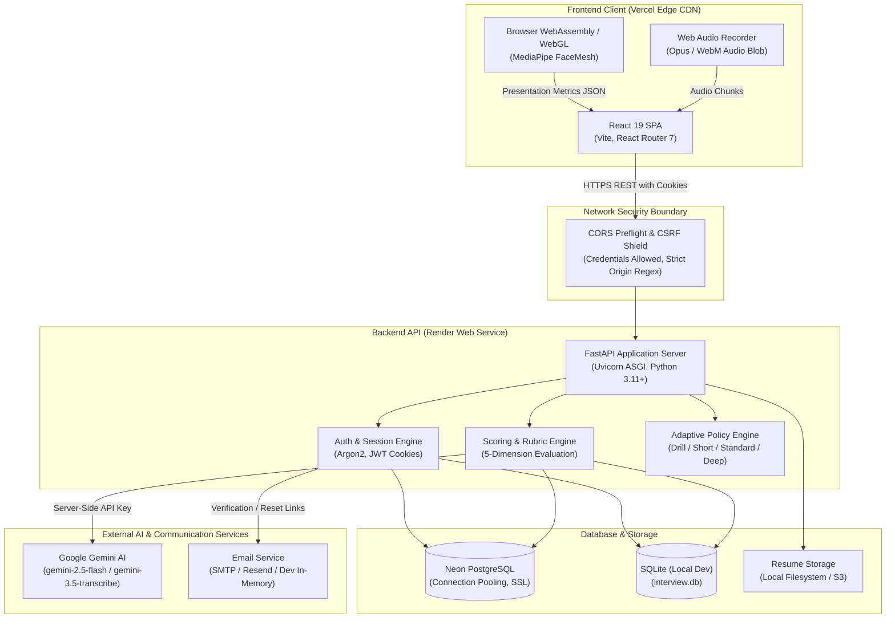

# AI Interview Intelligence System

A full-stack, multimodal interview preparation platform that analyzes candidate resumes, conducts adaptive technical mock interviews, evaluates responses against evidence-based rubrics, and tracks longitudinal engineering readiness.

Traditional technical interview preparation is frequently disconnected from real interview dynamics: candidates memorize static question sets, recite unverified claims from their resumes, and receive no real-time feedback on depth, structure, or communication delivery. This platform bridges that gap by grounding technical interview questions directly in extracted resume claims, generating dynamic architectural follow-ups, and assessing answers across multiple dimensions—including technical accuracy, communication structure (STAR), voice pacing, and local browser-based presentation stability.

---

## Live Deployments

| Component | URL | Status / Notes |
| :--- | :--- | :--- |
| **Frontend Application** | [interview-system-orpin.vercel.app](https://interview-system-orpin.vercel.app/) | Deployed on Vercel Edge Network |
| **Backend API Service** | [interview-intelligence-api-rla6.onrender.com](https://interview-intelligence-api-rla6.onrender.com/) | Deployed on Render (Web Service) |
| **Interactive API Docs** | [interview-intelligence-api-rla6.onrender.com/docs](https://interview-intelligence-api-rla6.onrender.com/docs) | Swagger UI / OpenAPI 3.0 |
| **Health Check Endpoint** | [interview-intelligence-api-rla6.onrender.com/health](https://interview-intelligence-api-rla6.onrender.com/health) | Liveness Probe |
| **Source Repository** | [github.com/AnkitX0/Interview_System](https://github.com/AnkitX0/Interview_System) | Main Branch |

> [!NOTE]
> **Render Free-Tier Spin-Down:** The backend is hosted on Render's free tier. If the service has been inactive, incoming requests trigger a cold start that takes approximately 30–45 seconds to spin up. Subsequent requests respond with normal sub-second latencies.

---

## Core Features

### 1. Resume Intelligence & Claim Verification
- **Multi-Format Ingestion:** Parses standard `PDF` documents (validated via `%PDF-` header signature) and Microsoft Word `DOCX` files (validated via Office Open XML ZIP structure containing `word/document.xml`).
- **Entity Extraction:** Extracts career timelines, educational credentials, and categorized technical skill inventories.
- **Claim & Buzzword Detection:** Flags vague ownership assertions, buzzword density, and unverified architectural claims for subsequent interview cross-examination.
- **Honest Score Gating:** Fallback logic gates scoring when extracted text confidence falls below minimum thresholds, preventing hallucinated evaluation metrics.

### 2. Adaptive Mock Interview Engine
- **Configurable Assessment Policies:**
  - `DRILL`: 3 focused questions targeting a single weak competency.
  - `SHORT`: 5–7 questions covering 2 core topics.
  - `STANDARD`: 8–12 questions covering 3 topics and 2 resume claim deep-dives.
  - `DEEP`: 12–18 questions evaluating complete architectural and systemic trade-offs.
  - `FULL`: Adaptive session dynamically pacing questions until sufficient evidence is collected (up to safety limit of 25).
- **Incident Response ("Pressure") Mode:** High-stakes troubleshooting scenario requiring rapid mitigation reasoning and structured incident triage under time constraints.
- **Dynamic Follow-Up Probing:** Analyzes candidate answer substance. If an answer lacks concrete implementation details or architectural rationale, the engine asks targeted follow-ups; if the answer is strong, it escalates difficulty with boundary conditions and trade-offs.
- **Question Exposure Engine:** Tracks historical question exposure per candidate to prevent repetition across multiple sessions.

### 3. Multi-Dimensional Answer Evaluation & AI Coaching
- **Structured Scoring Rubric:** Scores responses (0–100) across 5 core dimensions:
  1. *Technical Depth & Correctness*
  2. *Structure & Coherence* (STAR framework for behavioral, Trade-off matrices for technical)
  3. *Problem-Solving & Reasoning*
  4. *Behavioral Clarity & Impact*
  5. *Resume Claim Consistency*
- **"Fix This Answer" Coach:** Re-synthesizes candidate answers into concise, measurable STAR (Situation, Task, Action, Result) narratives using the candidate's authentic experience without fabricating achievements.

### 4. Audio Transcription & Speech Cadence Analysis
- **Full-Response Audio Processing:** Captures complete candidate audio answers, transmitting audio blobs to Google Gemini for speech transcription.
- **Pacing & Verbal Fluency:** Computes Words Per Minute (WPM), pause durations, and verbal filler frequency (`um`, `uh`, `basically`, `literally`, `like`).
- **Candidate Editing Freedom:** Transcribed responses are populated into an interactive editor allowing manual candidate review and corrections prior to formal evaluation.

### 5. Local Browser Visual Stability Tracking
- **100% In-Browser MediaPipe ML:** Uses `@mediapipe/face_mesh` and `@mediapipe/face_detection` executing client-side in WebAssembly/WebGL.
- **Delivery Stability Metrics:** Calculates visual centering, head movement stability, and approximate blink frequency.
- **Privacy Enforcement:** Raw video streams never leave the client browser. No video frames, biometric templates, or facial images are transmitted or stored on backend servers.
- **Zero Psychological Claims:** Visual metrics represent physical presentation stability only; the system explicitly disclaims emotion recognition or psychometric hiring predictions.

### 6. Authentication, Security & Data Privacy
- **Argon2 Password Hashing:** Secure password verification via `argon2-cffi`.
- **Credentialed HTTP-Only Cookies:** Cross-origin JWT sessions with `SameSite=None`, `Secure=True` for Vercel-to-Render communication (`SameSite=Lax` in local development).
- **Enumeration-Safe Password Recovery:** Uniform response timing and messaging on password reset and verification endpoints.
- **Rate Limiting:** Token-bucket rate limiting across authentication, verification, and reset endpoints.
- **GDPR / CCPA Data Rights:** Self-service data export (`GET /auth/export`) and complete account/session deletion (`DELETE /auth/account`).

---

## Architecture

The system utilizes an independent decoupled architecture where the static frontend client and stateful backend service deploy to dedicated environments optimized for their execution models.



### Monorepo Independent Deployment Rationale
Although the frontend and backend reside in a single Git repository for development cohesion:
1. **Frontend (Vercel):** Pure static Single-Page Application (HTML/JS/CSS). Deploying to Vercel provides global edge distribution, immediate asset caching, and zero idle container cost.
2. **Backend (Render):** Stateful Python service managing long-running database connection pools, multipart file parsing, cryptographic hashing, and protected server-side secrets (`GEMINI_API_KEY`, `DATABASE_URL`).
3. **Decoupled Lifecycle:** Changes to UI components do not necessitate restarting or rebuilding the Python application process.

---

## Technology Stack

### Frontend
- **Framework & Runtime:** React 19 (`react`, `react-dom`), React Router 7 (`react-router-dom`)
- **Build Tooling:** Vite 7, `@vitejs/plugin-react`
- **Data Visualization:** Recharts 3 (`recharts`) for competency radar charts and longitudinal performance trends
- **Computer Vision (Browser-Side):** Google MediaPipe (`@mediapipe/face_mesh`, `@mediapipe/face_detection`, `@mediapipe/camera_utils`)
- **Styling:** Custom CSS with structured design tokens (variables, glassmorphic surfaces, responsive layouts)

### Backend
- **Web Framework:** FastAPI (`fastapi`), Uvicorn ASGI server (`uvicorn[standard]`)
- **Data Layer & Migrations:** SQLAlchemy 2.0 ORM (`sqlalchemy`), Alembic (`alembic`), PostgreSQL adapter (`psycopg2-binary`)
- **Validation & Serialization:** Pydantic v2 (`pydantic`)
- **Security & Cryptography:** Argon2 (`argon2-cffi`), PyJWT (`pyjwt`), Python standard library `secrets`
- **Document Processing:** `python-docx` (Word processing), PyPDF
- **External AI Client:** Google GenAI SDK (`google-genai` accessing `gemini-2.5-flash`)
- **Email Providers:** Native SMTP client (`smtplib`), Resend HTTP API (`httpx`)

### Infrastructure
- **Production Database:** Neon Serverless PostgreSQL with connection pooling (`pool_pre_ping=True`)
- **Development Database:** SQLite with foreign key pragmas enabled
- **Hosting Platforms:** Vercel (Frontend SPA), Render (Backend Web Service)

---

## Repository Structure

```text
Interview_System/
├── backend/
│   ├── config.py                 # Central configuration, scoring weights & env parsing
│   ├── database.py               # Engine setup, connection pooling & auto-migrations
│   ├── main.py                   # FastAPI app, CORS middleware & health endpoints
│   ├── models/
│   │   └── models.py             # SQLAlchemy entities (User, Resume, Session, Answer, etc.)
│   ├── routes/
│   │   ├── analytics.py          # Dashboard, competency radar, velocity & readiness endpoints
│   │   ├── auth.py               # Register, login, verification, password reset, account export/delete
│   │   ├── interview.py          # Session turn execution, audio transcription & answer evaluation
│   │   ├── practice.py           # Targeted drills & recommended practice questions
│   │   ├── readiness.py          # Longitudinal readiness trends & timeline endpoints
│   │   └── resume.py             # PDF/DOCX upload, parsing & claim extraction
│   ├── schemas/
│   │   └── schemas.py            # Pydantic request & response schemas
│   ├── services/                 # Core domain logic
│   │   ├── auth_service.py       # Password validation, hashing & token generation
│   │   ├── email_service.py      # Provider abstraction (Dev Sandbox, SMTP, Resend)
│   │   ├── evaluation_llm.py     # Gemini client with fallback deterministic evaluation
│   │   ├── question_selector.py  # Adaptive question selection & policy enforcement
│   │   ├── scoring_engine.py     # Rubric scoring & evidence calculation
│   │   ├── storage_service.py    # Document storage abstraction (Local, S3)
│   │   └── ...
│   └── requirements.txt          # Python dependencies
├── frontend/
│   ├── public/                   # Static assets & icons
│   ├── src/
│   │   ├── components/           # Navbar, Layout, ProtectedRoute, ConsentModal, etc.
│   │   ├── context/              # AuthContext, ThemeContext, ReportContext
│   │   ├── pages/                # Application routes
│   │   │   ├── Dashboard.jsx     # Overview of readiness, history & next actions
│   │   │   ├── FixAnswer.jsx     # AI-assisted STAR coaching tool
│   │   │   ├── ForgotPassword.jsx# Password reset request page
│   │   │   ├── History.jsx       # Past interview sessions catalog
│   │   │   ├── Interview.jsx     # Active interview turn interface with audio/video
│   │   │   ├── InterviewSetup.jsx# Mode & policy selection before starting
│   │   │   ├── Landing.jsx       # Product introduction & feature overview
│   │   │   ├── Login.jsx         # User login form
│   │   │   ├── Profile.jsx       # Target role & skill configuration
│   │   │   ├── Progress.jsx      # Historical analytics & trend curves
│   │   │   ├── Register.jsx      # Account creation form
│   │   │   ├── Report.jsx        # Comprehensive interview evaluation scorecard
│   │   │   ├── ResetPassword.jsx # Password reset submission page
│   │   │   ├── ResumeUpload.jsx  # Resume file dropzone & claim extraction preview
│   │   │   └── VerifyEmail.jsx   # Email confirmation handler
│   │   ├── utils/
│   │   │   ├── api.js            # Centralized apiFetch with credential & error handling
│   │   │   ├── cameraTrackingLogic.js # MediaPipe landmark processing logic
│   │   │   └── ...
│   │   ├── App.jsx               # Client-side route declarations
│   │   ├── config.js             # API base URL resolution & environment parsing
│   │   └── main.jsx              # React DOM entry point
│   ├── package.json              # Frontend npm dependencies and scripts
│   ├── vercel.json               # Vercel SPA rewrite configuration
│   └── vite.config.js            # Vite build configuration
├── alembic/                      # Database migration versions
├── tests/                        # 36 pytest test modules (225 tests)
├── .env.example                  # Backend environment variable template
├── DEPLOYMENT.md                 # Production deployment operations manual
├── docker-compose.yml            # Local containerized orchestration
└── render.yaml                   # Infrastructure-as-code blueprint for Render
```

---

## Getting Started

### Prerequisites
- **Python:** 3.11 or newer (tested with Python 3.11, 3.12, 3.14)
- **Node.js:** 18.x or newer (recommended 20.x+) and `npm`
- **Git**

---

### Local Setup

#### 1. Backend Service
```bash
# Clone the repository
git clone https://github.com/AnkitX0/Interview_System.git
cd Interview_System

# Create and activate a Python virtual environment
python -m venv venv
source venv/bin/activate       # On Windows: venv\Scripts\activate

# Install dependencies
pip install -r backend/requirements.txt

# Create local environment file from template
cp .env.example .env

# Run database migrations (creates SQLite tables automatically)
alembic upgrade head

# Start FastAPI development server (runs on port 8001)
uvicorn backend.main:app --reload --port 8001
```

#### 2. Frontend Application
```bash
# In a new terminal window:
cd Interview_System/frontend

# Install Node dependencies
npm install

# Create local frontend environment file
cp .env.example .env.local

# Start Vite development server
npm run dev
```

Open your browser at `http://localhost:5173`. The local frontend automatically routes requests to `http://localhost:8001`.

---

## Configuration

### Backend Environment Variables (`.env`)

| Variable | Description | Default (Local Dev) | Production (Render) |
| :--- | :--- | :--- | :--- |
| `ENVIRONMENT` | Application mode (`development` \| `production`) | `development` | `production` |
| `DATABASE_URL` | SQLAlchemy connection string | `sqlite:///./interview.db` | `postgresql://...` (Neon) |
| `SECRET_KEY` | Secret key for JWT session cookies (min 32 chars) | Dev fallback key | *Random 64-char string* |
| `FRONTEND_URL` | Deployed origin allowed by CORS & CSRF | `http://localhost:5173` | `https://interview-system-orpin.vercel.app` |
| `CORS_ORIGIN_REGEX` | Regular expression for preview/branch deployments | *None* | `^https:\/\/.*\.vercel\.app$` |
| `AUTH_COOKIE_SAMESITE`| Session cookie SameSite policy | `lax` | `none` (Cross-site Vercel &harr; Render) |
| `AUTH_COOKIE_SECURE` | HTTPS-only cookie transmission | `false` | `true` |
| `GEMINI_API_KEY` | Google Gemini API key (server-side only) | *Optional* (falls back to deterministic) | *Required for live LLM* |
| `GEMINI_MODEL` | Gemini evaluation model | `gemini-2.5-flash` | `gemini-2.5-flash` |
| `EMAIL_PROVIDER` | Email provider (`development` \| `smtp` \| `resend`)| `development` | `development` or `resend` |
| `REQUIRE_EMAIL_VERIFICATION` | Enforce email verification before login | `false` | `false` (Instant demo access) |

### Frontend Environment Variables (`frontend/.env.local` or Vercel)

| Variable | Description | Local Dev | Production (Vercel) |
| :--- | :--- | :--- | :--- |
| `VITE_API_BASE_URL` | Base URL of the backend API service | `http://localhost:8001` | `https://interview-intelligence-api-rla6.onrender.com` |

> [!CAUTION]
> **No Secrets in Frontend:** Variables prefixed with `VITE_` are embedded directly into compiled client-side JavaScript. Never configure `GEMINI_API_KEY`, database connection strings, or `SECRET_KEY` in Vercel or `frontend/.env.local`.

---

## API Overview

The backend exposes RESTful endpoints with interactive documentation available at `/docs` (Swagger UI) and `/redoc` (ReDoc).

### Route Summary

| Module | Route Prefix | Description | Key Endpoints |
| :--- | :--- | :--- | :--- |
| **System** | `/` | Liveness & Readiness Probes | `GET /health`, `GET /health/ready` |
| **Authentication** | `/auth` | Identity, Session & Data Governance | `POST /register`, `POST /login`, `POST /logout`, `GET /me`, `POST /forgot-password`, `POST /reset-password`, `GET /export`, `DELETE /account` |
| **Resume Intelligence** | `/resume` | Ingestion & Claim Extraction | `POST /analyze` (Multipart PDF/DOCX or JSON), `GET /all`, `GET /{id}` |
| **Interview Engine** | `/interview` | Turn Execution & Evaluation | `POST /start`, `GET /{id}`, `POST /{id}/answer`, `POST /{id}/transcribe`, `POST /{id}/end`, `GET /{id}/report`, `POST /fix-answer` |
| **Analytics** | `/analytics` | Performance & Trend Insights | `GET /dashboard`, `GET /history`, `GET /readiness`, `GET /weaknesses`, `GET /velocity`, `GET /skills-radar` |
| **Practice** | `/practice` | Targeted Skill Drills | `POST /targeted`, `POST /start`, `POST /{id}/answer`, `GET /recommendations` |
| **Readiness** | `/readiness` | Longitudinal Competency Data | `GET /trend`, `GET /timeline` |

---

## Production Deployment

### 1. Frontend on Vercel
1. Import repository on [Vercel](https://vercel.com).
2. Configure build settings:
   - **Root Directory:** `frontend`
   - **Framework Preset:** `Vite`
   - **Build Command:** `npm run build`
   - **Output Directory:** `dist`
   - **Install Command:** `npm install`
3. Add Environment Variable:
   - `VITE_API_BASE_URL` = `https://interview-intelligence-api-rla6.onrender.com`
4. Deploy. The repository's `frontend/vercel.json` automatically configures SPA routing (`{"rewrites": [{"source": "/(.*)", "destination": "/index.html"}]}`) so route reloads on `/dashboard`, `/interview`, and `/report` function correctly.

### 2. Backend on Render
1. Create a **Web Service** on [Render](https://render.com) connected to the repository.
2. Build & Runtime settings:
   - **Runtime:** `Python`
   - **Build Command:** `pip install -r requirements.txt`
   - **Start Command:** `uvicorn backend.main:app --host 0.0.0.0 --port $PORT`
   - **Health Check Path:** `/health`
3. Add Environment Variables:
   - `ENVIRONMENT` = `production`
   - `DATABASE_URL` = *Connection string from Neon* (e.g. `postgresql://...@ep-....neon.tech/neondb?sslmode=require`)
   - `SECRET_KEY` = *Secure random string*
   - `GEMINI_API_KEY` = *Google AI Studio API key*
   - `FRONTEND_URL` = `https://interview-system-orpin.vercel.app`
   - `CORS_ORIGIN_REGEX` = `^https:\/\/.*\.vercel\.app$`
   - `AUTH_COOKIE_SAMESITE` = `none`
   - `AUTH_COOKIE_SECURE` = `true`
   - `REQUIRE_EMAIL_VERIFICATION` = `false`

### Troubleshooting Common Deployment Issues

| Issue | Symptom | Root Cause & Resolution |
| :--- | :--- | :--- |
| **Render Cold Start** | Initial request fails or spins for 30s | Free instances sleep after 15 minutes of inactivity. Frontend `apiFetch` detects Render hostnames and displays a clear retry prompt. |
| **CORS Blocked** | `400 Bad Request: Disallowed CORS origin` | The frontend origin is not present in `FRONTEND_URL` or does not match `CORS_ORIGIN_REGEX`. Ensure `CORS_ORIGIN_REGEX=^https:\/\/.*\.vercel\.app$` is set on Render. |
| **401 Unauthorized After Login** | Candidate logged in but subsequent requests fail | Cross-site cookie dropped by browser. Ensure `AUTH_COOKIE_SAMESITE=none` and `AUTH_COOKIE_SECURE=true` are set on Render and requests use `credentials: "include"`. |
| **Vercel Route 404** | Direct URL visits return 404 Not Found | Client-side routing rewrite missing. Verify `frontend/vercel.json` exists in the deployment output. |

---

## Testing & Quality Assurance

All suites have been executed and verified locally:

```bash
# 1. Backend Test Suite (Pytest)
source venv/bin/activate
pytest tests/

# 2. Frontend Speech & Audio Integration Tests
cd frontend
npm test

# 3. Production Bundle Build Verification
cd frontend
npm run build

# 4. Code Quality & Linter
cd frontend
npx eslint src/utils/api.js src/config.js
```

### Verified Test Results
- **Backend Tests:** **225 passed**, 0 failed across 36 test modules (execution time ~22s).
- **Frontend Integration Tests:** **20 passed**, 0 failed in `test_speech.mjs` verifying recording transitions, chunk assembly, MIME detection, and transcript insertion.
- **Production Build:** Vite compilation succeeds in ~2.8s producing minified HTML, CSS, and JS bundles without syntax or packaging errors.

---

## Known Limitations & Roadmap

### Current Limitations
- **Render Free-Tier Spin-Down:** Cold starts introduce 30–45s latency on the first request after an idle period.
- **Client-Side MediaPipe Hardware Dependency:** MediaPipe FaceMesh processing rate depends on local client GPU/CPU capabilities. Users on low-powered machines may experience reduced vision tracking FPS.
- **Single-Tenant User Isolation:** Database tenancy is scoped to individual users; organizational or recruiter team accounts are not yet supported.
- **External API Resilience:** While deterministic heuristic fallbacks exist for LLM answer evaluation, rich STAR coaching rewrites require an active Gemini API key.

### Planned Roadmap
- [ ] **Local Speech-to-Text Fallback:** Optional in-browser Whisper WebGPU transcription when external API quotas are constrained.
- [ ] **Multi-Tenant Recruiter Workspace:** Team portals with candidate comparative benchmarking and blinded rubric reviews.
- [ ] **System Design Interactive Whiteboard:** Multi-turn architectural diagramming evaluation with component relationship verification.
- [ ] **ATS Integration Webhooks:** Webhook payloads for exporting verified readiness scorecards into Greenhouse and Lever.

---

## Contributing & License

### Development Workflow
1. Fork the repository and create a feature branch (`git checkout -b feature/improved-rubric`).
2. Implement changes preserving existing architectural patterns.
3. Verify all backend and frontend tests pass (`pytest tests/` and `npm test`).
4. Ensure the production build completes cleanly (`npm run build`).
5. Submit a detailed Pull Request.

### License
This project is currently unlicensed for public redistribution. All rights reserved. Please contact the repository owner regarding usage terms or licensing inquiries.
